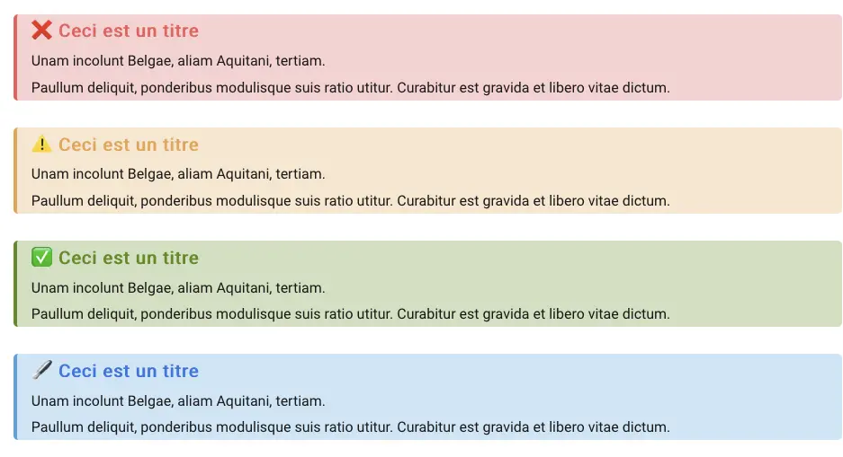

# Description

Code source de mon [blog](https://blog.victorprouff.fr/) perso.

# Voir version Hugo

```
hugo version
```

# Build le site

```
hugo
```

## Lancer serveur local

```
hugo server
```

## Ajouter un article 

```
 hugo new posts/nom-de-mon-article.md
```

## Mettre à jour le template

Aller dans le repos du fork du template.

Synchroniser le fork.

faire un git pull dans le thème en local

(themes/anatole)

## Ajouter un bloc de code

Il suffit d'ajouter :

```csharp
public class MaClass
{
    public MaClass()
    {
        // Constructor
    }

    public void Function()
    {
        // Function
    }
}
```

L'option linenos permet de rajouter les lignes.

[Doc](https://gohugo.io/content-management/syntax-highlighting/#example-highlight-shortcode)

## Modifier le style du code

```
hugo gen chromastyles --style=monokai > syntax.css
```

Liste de tous les styles : [lien](https://xyproto.github.io/splash/docs/all.html#abap)

## Activer l'interprétation HTML dans les fichiers md

Activer l'option en ajoutant le paramètre dans le fichier `config.toml`

```toml
[markup.goldmark.renderer]
  unsafe = true # Allow HTML in md files
```

Permet d'utiliser des balises html dans les articles et pages .md.

Comme centrer une image :

```html

```

et rajouter la class dans le fichier `custom.css`.

```css
.center {
    display: block;
    margin-left: auto;
    margin-right: auto;
}
```

## Améliorer le rendu des alerts

J'aime bien comment rende les alerts sur [github](https://docs.github.com/fr/get-started/writing-on-github/getting-started-with-writing-and-formatting-on-github/basic-writing-and-formatting-syntax#alerts) ou Obsidian mais malheureusement, ce n'est pas standard en markdown.

J'ai donc rajouté un peu de css pour avoir un rendu plus sympa 😊

Quand je veux faire une alert (mettre en avant du texte) au lieu de faire comme je faisais avant je fais :

```markdown
> [!info] Ceci est un titre
> Unam incolunt Belgae, aliam Aquitani, tertiam.
> 
> Paullum deliquit, ponderibus modulisque suis ratio utitur. Curabitur est gravida et libero vitae dictum.
```

Je fais :

```markdown
<blockquote class="alert-danger">
<h3>Ceci est un titre</h3>
Unam incolunt Belgae, aliam Aquitani, tertiam.

Paullum deliquit, ponderibus modulisque suis ratio utitur. Curabitur est gravida et libero vitae dictum.
</blockquote>

<blockquote class="alert-warning">
<h3>Ceci est un titre</h3>
Unam incolunt Belgae, aliam Aquitani, tertiam.

Paullum deliquit, ponderibus modulisque suis ratio utitur. Curabitur est gravida et libero vitae dictum.
</blockquote>

<blockquote class="alert-tip">
<h3>Ceci est un titre</h3>
Unam incolunt Belgae, aliam Aquitani, tertiam.

Paullum deliquit, ponderibus modulisque suis ratio utitur. Curabitur est gravida et libero vitae dictum.
</blockquote>

<blockquote class="alert-info">
<h3>Ceci est un titre</h3>
Unam incolunt Belgae, aliam Aquitani, tertiam.

Paullum deliquit, ponderibus modulisque suis ratio utitur. Curabitur est gravida et libero vitae dictum.
</blockquote>

> ### Ceci est un titre
> Unam incolunt Belgae, aliam Aquitani, tertiam.
> 
> Paullum deliquit, ponderibus modulisque suis ratio utitur. Curabitur est gravida et libero vitae dictum.

```

Je viens de rajouter une valeur par défaut. Vu que dans la majorité des cas, je n'ai besoin que de l'alert `Info`, si je fais une citation classique, c'est l'alert info qui est rendu. Si j'ai besoin d'un cas particulier, je le gère avec les blockquotes.

Et je rajoute le scss custom suivant à la fin de `/assets/sass/main.scss` :

```css
blockquote, .alert-info {
    border-left: 4px solid #0969da;
    border-radius: 5px;
    background-color: #ddf4ff;
    padding-left: 1em;
    color: black;

    h1, h2, h3, h4 {
        color: #0969da
    }
    
    h1::before, h2::before, h3::before, h4::before {
        content: "🖋️ ";
    }
}

.alert-tip {
    border-left: 4px solid #1a7f37;
    border-radius: 5px;
    background-color: #dafbe1;
    padding-left: 1em;
    color: black;

    h1, h2, h3, h4 {
        color: #1a7f37
    }
    
    h1::before, h2::before, h3::before, h4::before {
        content: "✅ ";
    }
}

.alert-warning {
    border-left: 4px solid #9a6700;
    border-radius: 5px;
    background-color: #fff8c5;
    padding-left: 1em;
    color: black;

    h1, h2, h3, h4 {
        color: #9a6700
    }
    
    h1::before, h2::before, h3::before, h4::before {
        content: "⚠️ ";
    }
}

.alert-caution {
    border-left: 4px solid #cf222e;
    border-radius: 5px;
    background-color: #ffebe9;
    padding-left: 1em;
    color: black;

    h1, h2, h3, h4 {
        color: #cf222e
    }
    
    h1::before, h2::before, h3::before, h4::before {
        content: "❌ ";
    }
}
```

Je copie colle le fichier `_dark.scss` de mon template pour le mettre à coté du fichier `main.scss` . Je rajoute la gestion du thème sombre, à l'intérieur `@mixin dark-mode {`

```css
@mixin dark-mode {

	[...]


  /** Custom Alert Styles **/
  blockquote, .alert-info {
      border-left: 4px solid #0969da;
      border-radius: 5px;
      background-color: #ddf4ff;
      padding-left: 1em;
      color: black;

      h1, h2, h3, h4 {
          color: #0969da
      }
      
      h1::before, h2::before, h3::before, h4::before {
          content: "🖋️ ";
      }
  }

  .alert-tip {
      border-left: 4px solid #1a7f37;
      border-radius: 5px;
      background-color: #dafbe1;
      padding-left: 1em;
      color: black;

      h1, h2, h3, h4 {
          color: #1a7f37
      }
      
      h1::before, h2::before, h3::before, h4::before {
          content: "✅ ";
      }
  }

  .alert-warning {
      border-left: 4px solid #9a6700;
      border-radius: 5px;
      background-color: #fff8c5;
      padding-left: 1em;
      color: black;

      h1, h2, h3, h4 {
          color: #9a6700
      }
      
      h1::before, h2::before, h3::before, h4::before {
          content: "⚠️ ";
      }
  }

  .alert-caution {
      border-left: 4px solid #cf222e;
      border-radius: 5px;
      background-color: #ffebe9;
      padding-left: 1em;
      color: black;

      h1, h2, h3, h4 {
          color: #cf222e
      }
      
      h1::before, h2::before, h3::before, h4::before {
          content: "❌ ";
      }
  }

}
[...]

```

Il y a peut-être moyen de faire plus simple mais je suis une quiche en CSS donc bon, ça fonctionne. Si vous avez mieux, dites-moi ! 😊

Et voila le résultat :



## Sources :

- https://gohugo.io/getting-started/usage/